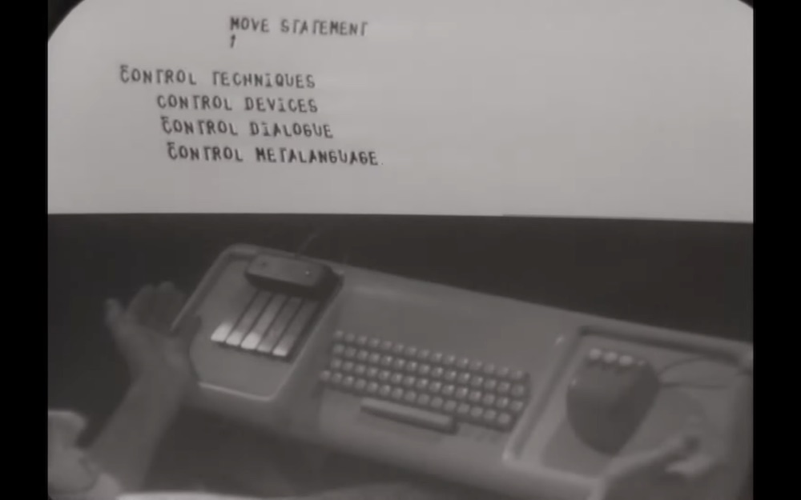

# Computer & computer art history
A set of links related to computer &amp; code history (english and french links)

[Douglas Engelbart — The mother of all demos](https://www.youtube.com/watch?v=UhpTiWyVa6k)

## Computer graphics & generative art history
* [Thomas Dreher — History of computer art](http://iasl.uni-muenchen.de/links/GCA-III.2e.html) *The early use of mainframe computers to generate texts provides us with one prehistory of computer graphics.*
* [Christoph Klütsch — The Concepts of Information and Aesthetic in Early Computer Art (1964-71)](http://www.computerkunst.org/Kluetsch_Art_Metaphysics_2006.pdf) *Pictorial information as part of a communication channel can be broken down to repertoires - a level of information theory - and be transformed by generative aesthetic to create macro aesthetic states.*
* [Sher Minn Chong — History of computer art -- part 1 : computer graphics](https://piratefsh.github.io/2019/01/07/computer-art-history-part-1.html) *I’m writing a series of blog posts on computer art history from the 1960s onwards. This is the first part and we’ll talk about the early beginnings of computer graphics. This is part of my work during a week-long programming retreat at the Recurse Center.*
* [Prehystories of new media](http://prehystories.blogspot.com/) *"Prehystories of New Media" class at The School of the Art Institute of Chicago (SAIC), Fall 2008 + 2009, instructor: Nina Wenhart*
* [Gérard Verroust — Histoire, épistémologie de l'informatique et Révolution technologique](https://www.epi.asso.fr/revue/89/b89p165a.htm)
  * La formalisation du calcul d'Al Khorizmi à TURING
  * Les instruments de calcul analogiques et numériques
  * L'histoire des automates et de l'horlogerie
  * La révolution industrielle et ses limites : Charles BABBAGE
  * L'évolution technologique jusqu'à la synthèse de Von NEUMANN (1947).
  * Rappels fondamentaux sur le fonctionnement d'une machine de Von NEUMANN ou ordinateur
  * Les "générations" d'ordinateurs : grandes étapes des techniques électroniques
  * La conquète de la mémoire
  * Les grandes classes de langages de programmation
  * Le dialogue homme-machine de la carte perforée à la réalité virtuelle.
  * Cybernétique et Systémique, automates neuronaux & connexionnistes
  * Le calcul en temps réel, la conduite de processus industriel, la robotique.
  * Révolution informationnelle, travail, production
  * Révolution informationnelle & éducation, vie sociale, familiale, culturelle.
* [Computer Drawing](https://computerdrawing.hypotheses.org/) *Ce carnet de recherche interroge sur le plan des arts les fondements du graphisme l’écriture du signe plastique et le design de données dans l’environnement numérique et dans une perspective d’analyse critique historique des formes de transcodage des données, sans se limiter au réseau internet et à l’écran.*
* [Les pionniers du Computer Art](http://archive.olats.org/livresetudes/basiques/animationnumerique/3_basiquesAN.php#1) *Les origines du Computer Art remontent aux années cinquante et soixante. Pendant cette période se sont déroulées les premières expérimentations graphiques d'« oscillographie géométrique » réalisées avec des écrans de radar, des oscilloscopes cathodiques et divers instruments électroniques. L’esthétique de « oscillographie géométrique » est marquée par les formes abstraites, les grilles géométriques, les « courbes de Lissajous » (superposition de courbes sinusoïdales) ainsi que des mouvements relativement simples.*
* [ Marie Lechner, Inke Arns, Sarah Garcin — Computer Grrrls](http://computer-grrrls.gaite-lyrique.net/) *Les femmes ont historiquement travaillé avec des machines, qu’elles soient dactylos, télégraphistes, opératrices de téléphonie, mécanographes, programmeuses. Elles ont souvent constitué une avant-garde temporaire dans le développement de technologies novatrices, avant d’être remplacées par les machines qui ont pris leur nom. Le terme “computer”, bien avant qu’il ne désigne l’ordinateur, qualifiait la personne, souvent une femme, qui faisait les calculs à la main.*
* [Jean-Noël Lafargue — Histoire de l'informatique](http://synchise.com/diaporamas/humanites_numeriques/Humanites_numeriques_02_histoire.pdf) *Diaporama*
* [George Dyson — The birth of computer](https://www.ted.com/talks/george_dyson_the_birth_of_the_computer) *Historian George Dyson tells stories from the birth of the modern computer -- from its 17th-century origins to the hilarious notebooks of some early computer engineers.*
* [Casey Reas — 50 Years of Software Artists: Plotter Drawings to Non-fungible Tokens — Fall 2021](https://docs.google.com/document/d/1Ip560adCBCBWFXlEinmvuEehjIcSj1BcxUGPiVKZ9fQ/edit#heading=h.4tsdr7tpyc1z) *Hybrid studio-style examination of the history of artists working with software from the 1960s to the present. Exploration of artists who have written their own code to explore media including plotter drawings, film, CD-ROMs, websites, and non-fungible tokens (NFTs). Discussion of readings, exploration of artworks, and discussion of student-made experiments. Students will read, watch, and create a series of code experiments.*
* [Amy Goodchild — Early computer art in the 50’s & 60’s](https://www.amygoodchild.com/blog/computer-art-50s-and-60s) *Computing and creativity have always been linked. In the early 1800’s when Charles Babbage designed the Analytical Engine, his friend Ada Lovelace wrote in a letter that, if music could be expressed to the engine, then it “might compose elaborate and scientific pieces of music of any degree of complexity or extent.”*
* [Le Random — Pre-Modern Era](https://timeline.lerandom.art/#/chapter-1) *Spanning tens of thousands of years, we begin by surveying the advancements in art, mathematics, science and computing history that led to the modern era of generative art.*
* [Frank Dietrich — Visual Intelligence: The First Decade of Computer Art (1965-1975)](https://sune.tistory.com/entry/Visual-Intelligence-The-First-Decade-of-Computer-Art-1965-1975) *The author traces developments in computer art worldwide from 1965, when the first computer art exhibitions were held by scientists, through succeeding periods in which artists collaborated with scientists to create computer programs for artistic purposes. The end of the first decade of computer art was marked by economic, technological and programming advances that allowed artists more direct access to computers, high quality images and virtually unlimited color choices.*

## Computers
* [When was the first computer invented](https://www.computerhope.com/issues/ch000984.htm) *There is no easy answer to this question due to the many different classifications of computers. The first mechanical computer, created by Charles Babbage in 1822, doesn't resemble what most would consider a computer today.*
* [Punch card](https://www.computerhope.com/jargon/p/punccard.htm) *Punch cards (or "punched cards"), also known as Hollerith cards or IBM cards, are paper cards where holes may be punched by hand or machine to represent computer data and instructions.*
* 📽 [Computer History Archives Project  ("CHAP")](https://www.youtube.com/@ComputerHistoryArchivesProject) *We create and provide Educational and Historical video presentations on COMPUTER HISTORY and vintage technology, including restored footage with commentary, for educational purposes, user comment and discussion.  Our channel is an independent educational research activity and our goal is to help make computer history data accessible to everyone.*

## Computer pionneers

### Ada Lovelace
* [France Culture / Ada Lovelace, la grande ordinatrice](https://www.franceculture.fr/emissions/la-methode-scientifique/ada-lovelace-la-grande-ordinatrice) *Quelle a été la vie de la comtesse anglaise Ada Lovelace ? Quels ont été ses recherches et travaux qui ont fait d’elle la première personne de l’Histoire à avoir créé un programme informatique ? A quelle machine s’intéressait-elle, à quels problèmes mathématiques ?*
* [Stephen Wolfram — Untangling the tale of Ada Lovelace](https://blog.stephenwolfram.com/2015/12/untangling-the-tale-of-ada-lovelace/)
 *To some she is a great hero in the history of computing; to others an overestimated minor figure. I’ve been curious for a long time what the real story is. And in preparation for her bicentennial, I decided to try to solve what for me has always been the “mystery of Ada”.*
* [Two-Bit History — What Did Ada Lovelace's Program Actually Do?](https://twobithistory.org/2018/08/18/ada-lovelace-note-g.html)
 *In fairness, Lovelace’s program is not easy to explain to the layperson without some hand-waving. It’s the intricacies of her program, though, that make it so remarkable. Whether or not she ought to be known as “the first programmer,” her program was specified with a degree of rigor that far surpassed anything that came before.*
* [Cherchez la femme ! Ada Lovelace — L'invention de l'ordinateur](https://www.arte.tv/fr/videos/090626-014-A/cherchez-la-femme) *Pour les médecins de l'époque, c'est "l'utérus sauteur" d'Ada Lovelace (1815-1852) qui serait à l’origine de son tempérament scientifique. Une théorie loufoque qui permet de minimiser ses réussites : première programmeuse de l'histoire, la fille du poète lord Byron a mis au point l’algorithme de la machine à calculer imaginée par le mathématicien Charles Babbage.*

### Alan Turing
* [France Culture / Grande traversée : l'énigmatique Alan Turing](https://www.franceculture.fr/emissions/lenigmatique-alan-turing)
   * Les mythologies d'Alan Turing.
   * Le bug.
   * Des marguerites à l'ordinateur.
   * Enigma, la guerre du code.

##### Turing machine
* [Interstice.info — Comment marche une machine de turing ?](https://interstices.info/comment-fonctionne-une-machine-de-turing/) *Essayons de faire quelque chose de paradoxal : montrer concrètement comment marche une machine abstraite !
Car c’est bien une machine abstraite qu’Alan Turing a inventée pour expliquer la notion de « procédure mécanique » : on parle d’algorithme. Cette machine est la plus élémentaire possible destinée à mettre en œuvre ces mécanismes de calcul, numériques ou symboliques, comme le font notamment les ordinateurs.*

## Generative art pionneers 
* [Group of Art and Informatique of Vincennes](https://artinfo-musinfo.org/en/index.html) *More than fifty years ago, a group of painters, musicians, psychologists, educators, linguists, mathematicians, poets, architects and computer scientists gathered within the Computer Science Department of the University of Vincennes to form what became known as the "Group of Art and Informatique of Vincennes".*
* 📽 [New Tendencies](https://www.youtube.com/watch?v=uxAA9QtLrSo) *During the period 1961-1973, five international exhibitions were organized under the title New Tendencies in Zagreb, Croatia/Yugoslavia. They continued the development of ideas raised by Exat 51 during the 1950s, and formed part of the broader European post-informel art movement in the 1960s and 70s.*
* [A longer history of generative art](https://www.rightclicksave.com/article/a-longer-history-of-generative-art) *One of the world’s leading scholars of computer art, Nick Lambert, traces a history of generative aesthetics up to NFTs*
* [When the artists met the algorist](https://www.rightclicksave.com/article/when-the-artists-met-the-algorist) *After a pioneer of generative art reached out to RCS, the community jumped at the chance to talk to Roman Verostko*
* 📽 [Generative Art Exploration Chapter I Tracing the Roots: The History of Generative Art](https://www.youtube.com/watch?v=d2LC6Am9bZI) *Embark on a captivating journey through the history and evolution of Generative Art. In the first chapter, delve into its rich history, exploring pioneers and the transformative power of algorithmic creativity. Discover the underlying principles and concepts that drive Generative Art, witnessing the remarkable synergy between human ingenuity and digital innovation. Learn from experts in the field, gaining insight into the profound impact of algorithmic creativity on the artistic landscape.*
### Colette & Charles Bangert
* [40 Years of Algorithmic Drawing - Begin. / Colette & Charles Bangert](http://fromheretofaraway.com/Block000.html)

### Harold Cohen 
* [The prophecies of AARON](https://outland.art/harold-cohen-aaron/) *In 1973, Harold Cohen created a computer program that could paint and draw. Where does his invention fit in current debates about AI and art?*
 
### Herbert W. Franke
* [AB 101: Historical Figures in Generative Art — Herbert W. Franke](https://medium.com/the-link-art-blocks/ab-101-historical-figures-in-generative-art-herbert-w-franke-48911e977096) *Herbert W. Franke is many things — among them, an early computer art pioneer. His resume includes accomplished academic, teacher, fiction writer, cave researcher, computer artist, collector, and theoretician.*
* [Math goes art / A solo show | Kate Vass gallery](https://www.katevassgalerie.com/math-goes-art-by-herbert-w-franke) *The emergence of art is associated with man's desire to learn about the world around him. Art became a powerful tool in the struggle for existence. It helped to create a model of the world, to study it and identify relationships. As human developed, he took art to a new level, which promoted a man to a new development stage.*

### Desmond Paul Henry
[Gallery on Flickr](https://www.flickr.com/photos/desmondpaulhenry/) *Desmond Paul Henry (1921-2004) ranks among one of the few early British pioneers of Computer Art/Graphics of the 1960's. During this period he constructed a total of three mechanical drawing machines (in 1960, '63 and '67) based around the components of analogue bombsight computers.*

### Manfred Mohr
* [Art & Algorithms : the work of Manfred Mohr](https://www.litrony.com/2019/12/art-and-algorithms-the-work-of-manfred-mohr-by-charlotte-kent/) *Mohr had been an abstract painter and a musician before he turned to computers. He played the tenor saxophone and oboe in jazz clubs across Europe and was a member of the band Rocky Volcano.*
* [In the studio with Manfred Mohr](https://youtu.be/7stpmUqManU) *AAA (American Abstract Artists) member and digital-art pioneer Manfred Mohr shares his studio practice, processes and stories in a short film by Christian Nguyen.*

### Vera Molnar
* [The Art of Vera Molnar 1947-1974 / Ahmad Moussa](https://www.gorillasun.de/blog/the-art-of-vera-molnar/) *When it comes to early generative art, one name that resonates is Vera Molnár's. She has been at the forefront of computer-generated art since the late 1960s.*
* [HOLO magazine / Vera Molnar / Weaving Variations](https://www.holo.mg/dossiers/vera-molnar-weaving-variations/) *Augmenting Molnar’s first U.S. solo exhibition, Zsofi Valyi-Nagy parses the legacy of the nonagenarian generative art pioneer.*
* [INA / Vera Molnar sur le rôle de l'ordinateur dans la création artistique](https://www.ina.fr/video/I18089373) *L'artiste peintre Vera MOLNAR déclare que l'attitude romantique de l'artiste, l'intuition, est en contradiction avec l'ordinateur. Un de ses rêves est de créer un robot qui travaillera toutes les nuits comme un esclave en exécutant ce qu'elle veut, il aura en mémoire toutes ses créations passées et fera une liste des choses qu'elle n'a pas faites.*
* [INA / L'apport de l'ordinateur dans la peinture](https://www.ina.fr/video/I18089371) *Dans l'atelier moderne de la peintre Vera MOLNAR, équipé d'ordinateurs et d'imprimantes, elle explique l'apport de l'ordinateur dans le travail des artistes qui permet notamment la recherche scientifique dans l'art.*
* [Les dessins assistés par ordinateurs de Véra Molnar / cours de Séverine Braud](https://www.profartspla.info/media/arisoft/pdfjs/web/viewer.html?file=https%3A%2F%2Fwww.profartspla.info%2Fimages%2Flycee%2F2021%2FVeraMolnar.pdf) *« Un angle droit commence à être excitant quand il dévie un peu et s’ouvre ou se ferme imperceptiblement »*
* [AB 101: Historical Figures in Generative Art — Vera Molnár](https://medium.com/the-link-art-blocks/ab-101-historical-figures-in-generative-art-vera-moln%C3%A1r-b2c5f64fccd8) *Vera Molnár is a Hungarian artist living in France that’s considered the first female computer artist. Molnár’s creative career started long before computers, focusing on abstract and geometrical paintings.*

### Michael Noll
* [Right Click Save / Michael Noll Interview](https://www.rightclicksave.com/article/the-interview-a-michael-noll) *One of the fathers of computer art discusses his career at Bell Labs and beyond with Douglas Dodds*

### Lillian Schwartz
* [Video / Lillian Schwartz](https://vimeo.com/98960229) *Here's OCR's interview with computer art pioneer Lillian Schwartz, filmed at her home in Manhattan in April, 2014. Video produced by the Office for Creative Research for the 2014 Eyeo Festival.*

### Wacław Szpakowski
* [Rhythmical Lines](https://www.theparisreview.org/blog/2017/02/15/rhythmical-lines/) *Working in isolation, Wacław Szpakowski made mazelike drawings from single, continuous lines.*

### Joan Truckerbrod
* [Gallery of artworks](https://joantruckenbrodart.com/algorithmic-art-gallery.html)

## Exhibitions
* [Computer Graphik](http://dada.compart-bremen.de/item/exhibition/171) *“Computer-Grafik” was the third public show in history of artistic works programmed for a digital computer and executed by a computer-controlled drawing machine (“plotter”).*
* 📽 [Arte programmata](https://www.youtube.com/watch?v=iji_cT9L6RQ) *Italian Kinetic Art from the 1960s*
  * [Arte programmata catalogue](https://www.docdroid.net/Me19TNE/arte-programmata-catalogue-compressed-pdf) *M&L FINE ART, LONDON, 4 OCTOBER - 20 DECEMBER 2016*
  * [Arte programmata](https://monoskop.org/images/b/be/Caplan_Lindsay_2018_From_Collective_Creation_to_Creating_Collectives_Arte_programmata_and_the_Open_Work_1962.pdf) *From Collective Creation to Creating Collectives: Arte programmata and the Open Work, 1962*
* [Cybernetic Serendipity](https://cyberneticserendipity.net/) *The Institute of Contemporary Arts in London, 1968*
  * [on socks-studio](https://socks-studio.com/2011/12/08/cybernetic-serendipity-1968-the-computer-and-the-arts/)  
* [Manfred Mohr — Une esthétique programmée](http://www.emohr.com/paris-1971/index.html) *Musée d'Art Moderne de la Ville de Paris, Mai 1971*
* [Curating The American Algorists: Digital Art and National Identity](https://www.mdpi.com/2076-0752/8/3/106/htm) *This essay details the curating strategies and central premise behind the 2013 traveling exhibition The American Algorists: Linear Sublime. This group exhibition, which showcased the artwork of Jean-Pierre Hébert, Manfred Mohr, Roman Verostko, and Mark Wilson, marked the 20th anniversary of New York Digital Salon.*
* [Behind the Yugoslav art movement that predicted the birth of digital art](https://www.calvertjournal.com/features/show/13223/behind-the-yugoslav-art-movement-that-predicted-the-birth-of-digital-art) *Sixty years ago, a modest exhibition featuring a group of little-known artists opened in the Gallery of Contemporary Art in Zagreb, capital of what was then the Croatian republic of a federal Yugoslavia. Named Nove Tendencije, or New Tendencies, it aimed to represent a snapshot of what was happening in the art world of the time.*
* [An Uncanny Display: Algorithmic Art at the Whitney Museum](https://blogs.scientificamerican.com/observations/an-uncanny-display-algorithmic-art-at-the-whitney-museum/) *A new show looks back over a half century of this surprisingly robust genre*

### Archives & Museums
* [Compart](http://dada.compart-bremen.de/) *The compArt database Digital Art (daDA) is a growing repository on digital art. It currently focusses on five top categories: people (in their roles as artists, authors, gallerists, etc.), works, events, publications, and institutions.*
* [Digital Art Museum](http://dam.org/home) *Digital Art Museum is an online resource for the history and practice of digital fine art. It informs on historical and on contemporary positions choosen by an advisory panel. It exhibits the work of leading Artists in this field since 1956.*
* [The Anne and Michael Spalter Digital Art Collection (Spalter Digital),](http://spalterdigital.com/) *The Anne and Michael Spalter Digital Art Collection (Spalter Digital), is one of the world’s largest private collections of early computer art, comprising over 750 works from the second half of the twentieth century. Spalter Digital, which focuses on plotter drawings but includes other 2D media as well as sculpture and 16mm film, is home to major and iconic examples from key artists in the field.*
* [The Recode Project](http://www.recodeproject.com/) *The ReCode Project is a community-driven effort to preserve computer art by translating it into a modern programming language (Processing). Every translated work will be available to the public to learn from, share, and build on.*

### Generative art
#### Truchet tiling
* [Jean-Noël Lafargue - L'improvisateur de tissus (1871)](https://hyperbate.fr/dernier/?p=42335) *Le 28 juillet 1871, face à l’Académie d’Amiens, l’ingénieur textile Édouard Gand a présenté ses travaux sur ce que l’on peut considérer comme un des tout premiers exemples — sinon le premier exemple véritable — de design génératif mécanique.*
* [Jacques André - Truchet et les pavages](http://jacques-andre.fr/faqtypo/truchet/index.html#pavages) *Les pavages étudiés par Truchet*
* [Guillaume Pelletier-Auger - Les pavages de Truchet](https://pelletierauger.com/fr/projets/les-pavages-de-truchet.html) *Errances dans les mathématiques françaises du XVIIIe siècle.*

### Languages + tools
* [Strange Loop 2019 - Recreating forgotten programming languages, for art!](https://about.sourcegraph.com/strange-loop/strange-loop-2019-recreating-forgotten-programming-languages-for-art) *The early beginnings of computer graphics in the 1960s saw the birth of a number programming languages that were created specifically for making animations and graphics.*
* [Video / The mother of all demos ](https://www.youtube.com/watch?v=yJDv-zdhzMY) *The Mother of All Demos is a name given retrospectively to Douglas Engelbart's December 9, 1968, demonstration of experimental computer technologies that are now commonplace. The live demonstration featured the introduction of the computer mouse, video conferencing, teleconferencing, hypertext, word processing, hypermedia, object addressing and dynamic file linking, bootstrapping, and a collaborative real-time editor.*
* [Video / The incredible machine](https://www.youtube.com/watch?v=iwVu2BWLZqA) *Interesting old film detailing advancements in computer/digital technology, featuring the 'Graphic 1' computer system at Bell Telephone Laboratories.*
* [Video / Sketchpad](https://www.youtube.com/watch?v=57wj8diYpgY) *Demonstration of Ivan Sutherland's classic Sketchpad system.  Sketchpad, and its associated thesis, is one of the most influential theses in computer science, and it laid the foundation for a very large part of what we take for granted today (and then some) from the perspective of how we interact with computers*
* [PAST AND FUTURE TURTLES: THE EVOLUTION OF THE LOGO PROGRAMMING LANGUAGE](https://turtlespaces.org/2021/05/21/past-and-future-turtles-the-evolution-of-the-logo-programming-language-part-1/) *That afternoon in 1981, I had learned some of a programming language called Logo. The father of Logo was a mathematician and philosopher named Seymour Papert. Interested in learning how to improve mathematics education in young children, in the early 1960s, he had studied under Jean Piaget, a Swiss psychologist who championed a philosophy of learning known as constructivism.*

### Books
* [Casey Reas / list of books](https://twitter.com/REAS/status/1473041398962159617) *I spent a ton of time this year writing about "Code Art" from the olden times to the present. I'm going to share some of the bibliography for the olden stuff over the next few days... for fun :)*
* [Raphaël de Courville / list of generative art books](https://twitter.com/sableraph/status/1427649830491496448) *I believe that successful #generativeArt collectors will be the ones who understand the history of computer art 🤓 Here are some good reads / coffee table conversation starters to get you started.*

### Magazines

* [Computer Graphics & Art](http://indexgrafik.fr/computer-graphics-art/)  *Computer Graphics & Art was an excellent quarterly publication highly focused in computer graphics and computer artists who were using and experimenting with this media back in the 70’s. It was produced in Chico, CA and published by Berkeley Enterprises Inc.*

* [The Art Of Computer Designing: A Black and White Approach / Osamu Sato](https://archive.org/details/satoArtOfComputerDesigning/mode/2up) *The computer is a magic box. Many graphic images are hidden inside it. This book is a beginner's introduction to calling forth these images as author Sato shows how to create figures with basic shapes - i.e., lines, arcs, squares and circles - and does so simply, clearly, and above all very logically.*

### Generalist articles
* [How Computer Code Became a Modern Design Medium — an Oral History](https://eyeondesign.aiga.org/how-an-mit-research-group-turned-computer-code-into-a-modern-design-medium/) *Bauhaus meets binary* 
* [The social conscience of generative art](https://www.artnews.com/art-in-america/features/max-bense-gustav-metzger-generative-art-1202674265/) *After the advent of the mainframe in the 1940s, it took less than two decades for computers to reach beyond the confines of military R&D to become a widely used platform for artistic experimentation*
* [The tools of Generative Art, from Flash to Neural Networks](https://www.artnews.com/art-in-america/features/generative-art-tools-flash-processing-neural-networks-1202674657/) *Like it or not, we are all computer nerds now. All aspects of our lives are driven by computation and algorithms: how we learn, work, play, even date. Given this situation, one could argue that generative art—work created at least in part with autonomous, automated systems—is the art that best reflects our time.*
* [Nodi3D, Machines Making Art, and Eigenvectors / Chris Ried](https://generative.substack.com/p/nodi3d-machines-making-art-and-eigenvectors) *I've started adding artists from the last 120 years into a spreadsheet as the first attempt at some of the timeline work I had referred to a few months ago. Right now, being that generative art is rather new, I've found it a bit harder to find dates on artists than I personally thought.*
* [NYTimes — The Secret History of Women in Coding](https://www.nytimes.com/2019/02/13/magazine/women-coding-computer-programming.html)
 *Computer programming once had much better gender balance than it does today. What went wrong?*
* [Systèmes : logiques, graphies, matérialités / dirigé par Kim Sacks, Victor Guégan](https://journal.dampress.org/issues/systemes-logiques-graphies-materialites) *Corpus de contributions qui questionnent, chacune à leur manière, les formes de logiques computationnelles, d’abord au sein du design, des arts et des médias, puis par extension, les idéologies soutenant un monde gouverné par la quantification, la statistique, la grille, la répétition, en somme, les structures mathématiques.*

